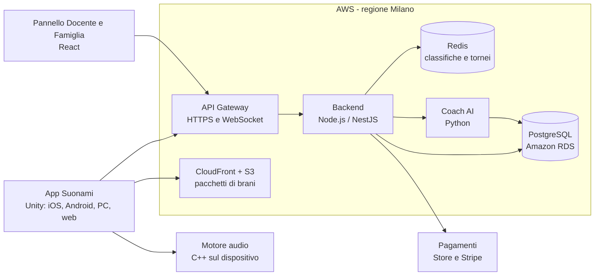
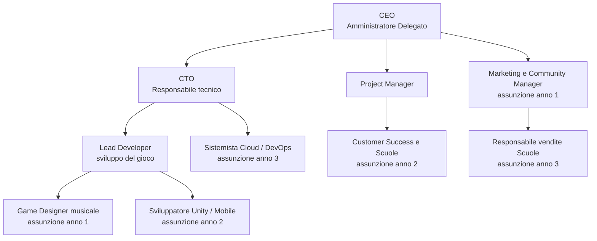
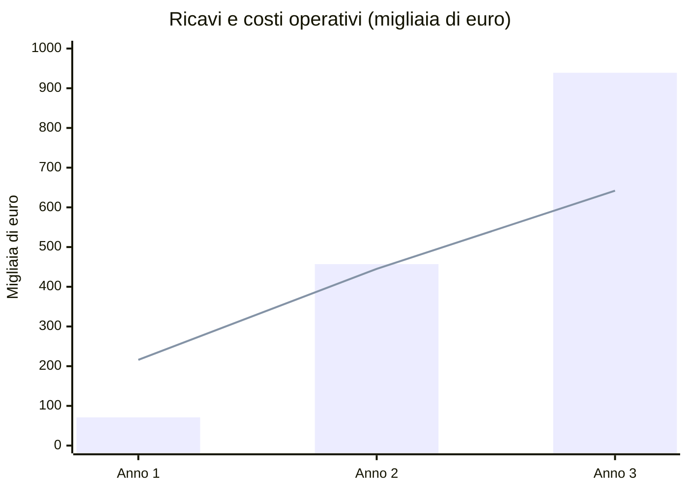

# Business Plan – Suonami S.r.l.

**Impara a suonare uno strumento vero, giocando**

*Start-up Innovativa · Documento riservato per investitori · Novembre 2026*

---

## Indice

1. [Executive Summary](#1-executive-summary)
2. [Descrizione dell'azienda e del prodotto](#2-descrizione-dellazienda-e-del-prodotto)
3. [Analisi di mercato e strategia di marketing](#3-analisi-di-mercato-e-strategia-di-marketing)
4. [Piano di organizzazione e risorse umane](#4-piano-di-organizzazione-e-risorse-umane)
5. [Piano finanziario](#5-piano-finanziario)
6. [Rischi e contromisure](#6-rischi-e-contromisure)
7. [Fonti e ipotesi](#7-fonti-e-ipotesi)

---

## 1. Executive Summary

### Chi siamo

**Suonami S.r.l.** è una start-up innovativa fondata da quattro sviluppatori e analisti appassionati di musica e videogiochi. Abbiamo creato una piattaforma, disponibile come app per smartphone, tablet e computer, che **insegna a suonare uno strumento musicale vero attraverso i videogiochi**. Si imbraccia la chitarra o ci si siede alla tastiera, l'app "ascolta" attraverso il microfono ogni nota suonata e la trasforma in punti, livelli e sfide.

### Vision

Un mondo in cui chiunque, a qualsiasi età, possa imparare a suonare con la stessa voglia con cui gioca al suo videogioco preferito.

### Mission

Rendere lo studio della musica divertente, accessibile ed economico, unendo il coinvolgimento del gioco al rigore della didattica musicale, per gli appassionati a casa e per gli studenti a scuola.

### Il problema

- **Imparare uno strumento è difficile e spesso noioso.** La maggior parte dei principianti abbandona nei primi mesi, perché gli esercizi tecnici sono ripetitivi e i progressi sembrano lenti.
- **Le lezioni private costano.** Un corso settimanale con un insegnante può superare i 100 € al mese: per molte famiglie è una spesa troppo alta.
- **I giovani passano ore sui videogiochi**, ma quel tempo raramente si trasforma in una competenza reale.
- **Nella scuola media la musica è materia obbligatoria**, ma i docenti hanno poche ore e strumenti digitali limitati per seguire i progressi di ogni studente.
- Le app internazionali esistenti sono pensate per il mercato anglosassone, hanno abbonamenti costosi e non sono progettate per la scuola italiana.

### La soluzione

Suonami trasforma lo studio in un videogioco:

1. **Modalità Avventura:** un mondo a livelli con personaggi e una storia, in cui si avanza imparando note, accordi e ritmi.
2. **Arena Ritmo:** si suonano brani reali, a tempo, con punteggio sulla precisione di ogni nota.
3. **Sfide e tornei:** classifiche settimanali, sfide tra amici e modalità **Band online**, in cui ognuno suona uno strumento diverso nello stesso brano.
4. **Coach AI:** l'intelligenza artificiale riconosce gli errori di intonazione e di tempo e adatta la difficoltà al livello del giocatore.
5. **Suonami Scuola:** una versione per le classi, con pannello per il docente, compiti assegnabili e monitoraggio dei progressi.

Si parte con **chitarra, ukulele e tastiera/pianoforte**, e si aggiungono flauto dolce, basso e batteria elettronica dal secondo anno.

### Fabbisogno finanziario

Chiediamo **260.000 €** a un Business Angel o a un fondo seed, che si aggiungono a **20.000 €** di capitale versato dai soci (totale **280.000 €**). In cambio offriamo il **20% delle quote** (valutazione pre-money di 1.040.000 €).

| Utilizzo dei fondi | Importo | % |
|---|---:|---:|
| Copertura dei costi operativi fino al pareggio (team, cloud, marketing, licenze musicali) | 207.000 € | 74% |
| Investimenti iniziali (CapEx) | 22.300 € | 8% |
| Riserva di sicurezza | 50.700 € | 18% |
| **Totale** | **280.000 €** | **100%** |

### I numeri chiave

| | Anno 1 (2027) | Anno 2 (2028) | Anno 3 (2029) |
|---|---:|---:|---:|
| Abbonati paganti (a fine anno) | 2.797 | 9.283 | 15.128 |
| Scuole con licenza attiva | 20 | 74 | 141 |
| Ricavi | 71.295 € | 456.800 € | 938.771 € |
| EBITDA (margine operativo lordo) | −144.738 € | **+11.729 €** | **+296.524 €** |

**Pareggio mensile al 21° mese (settembre 2028)**, con circa 7.500 abbonati paganti. Investimento interamente recuperato dalla cassa generata entro **settembre 2029**.

> **Perché investire in Suonami**
> - Unisce due mercati enormi e in crescita: **videogiochi** ed **educazione online**.
> - Ricavi ricorrenti da abbonamento (B2C) più licenze annuali per le scuole (B2B): due fonti di entrata che si rafforzano a vicenda.
> - Tecnologia proprietaria di riconoscimento audio che funziona sul dispositivo, senza costi di server per l'ascolto.
> - Prodotto pensato per l'Italia: lingua, repertorio musicale e programmi della scuola media, dove i grandi concorrenti internazionali sono deboli.
> - Margine lordo superiore all'80% e struttura dei costi leggera.

---

## 2. Descrizione dell'azienda e del prodotto

### 2.1 Forma giuridica: Start-up Innovativa S.r.l.

Costituiremo una **società a responsabilità limitata iscritta nella sezione speciale del Registro delle Imprese come start-up innovativa** (D.L. 179/2012). La scelta è motivata da:

- **Responsabilità limitata:** i soci rischiano solo il capitale conferito.
- **Requisiti soddisfatti:** oggetto sociale esclusivamente tecnologico e innovativo; spese in ricerca e sviluppo superiori al 15% dei costi; registrazione del software proprietario (motore di riconoscimento audio) nel Registro Pubblico Speciale per i Programmi per Elaboratore.
- **Vantaggi per chi investe:** gli investitori in start-up innovative possono beneficiare di **detrazioni fiscali IRPEF** sull'importo investito.
- **Vantaggi per la società:** esenzione da alcuni diritti camerali e bolli, accesso semplificato al Fondo di Garanzia per le PMI, possibilità di equity crowdfunding, accesso a bandi come Smart&Start Italia (Invitalia), possibilità di remunerare il personale con stock option.
- **Capitale sociale:** 20.000 €, versato in parti uguali dai quattro soci fondatori.

### 2.2 Il prodotto

| Componente | Utente | Funzioni principali |
|---|---|---|
| **App Suonami** (iOS, Android, PC/Mac, browser) | Giocatori di tutte le età | Modalità Avventura, Arena Ritmo, tornei, Band online, Coach AI, profilo con livelli, badge e serie di giorni consecutivi |
| **Pannello Docente** (web) | Insegnanti di musica | Gestione delle classi, assegnazione di brani ed esercizi, report dei progressi di ogni studente, modalità "classe" sulla LIM |
| **Pannello Famiglia** | Genitori | Tempo di pratica, progressi, controllo parentale |

**Come funziona l'ascolto:** l'app usa il microfono del dispositivo per riconoscere in tempo reale le note e gli accordi suonati su uno strumento acustico; tastiere e batterie elettroniche si possono collegare anche via cavo USB/MIDI per una precisione ancora maggiore. Non serve nessun accessorio speciale.

**Il catalogo musicale** combina tre fonti: brani originali composti dal nostro team (costo zero di diritti), brani di pubblico dominio (musica classica e popolare italiana) e brani famosi concessi in licenza da editori musicali, che rendono il gioco più attraente.

### 2.3 Architettura tecnica

| Livello | Tecnologia | Motivazione |
|---|---|---|
| Client di gioco | **Unity** (C#) | Un solo codice per iOS, Android, PC/Mac e browser; grafica 2D/3D fluida |
| Motore audio | Libreria nativa **C++** con algoritmi di analisi della frequenza (FFT e stima del pitch) | Bassa latenza (< 30 ms); l'audio viene analizzato sul dispositivo e **non viene mai inviato ai server**, a tutela della privacy |
| Cloud | **Amazon Web Services**, regione Milano (eu-south-1) | Dati in Italia (conformità GDPR), scalabilità automatica |
| Backend | **Node.js** (NestJS) con API REST e **WebSocket** | Account, progressi, acquisti; WebSocket per tornei e modalità Band in tempo reale |
| Database | **PostgreSQL** (Amazon RDS) + **Redis** | PostgreSQL per utenti e progressi; Redis per classifiche in tempo reale |
| Contenuti | **Amazon S3 + CloudFront** | Distribuzione veloce dei pacchetti di brani in tutta Italia |
| Motore AI | Microservizio **Python** | Algoritmo proprietario di difficoltà adattiva e percorsi di studio personalizzati |
| Pannelli web | **React** | Interfaccia moderna per docenti e famiglie |
| Pagamenti | App Store, Google Play, **Stripe** (web e scuole) | Abbonamenti e fatturazione alle scuole |
| Sicurezza | HTTPS/TLS, cifratura dei dati, controllo parentale, conformità GDPR per i minori | Protezione dei dati dei giovani utenti |

### 2.4 Innovazione tecnologica: perché siamo migliori

1. **Riconoscimento audio proprietario sul dispositivo.** Il nostro motore riconosce note singole e accordi da uno strumento vero, anche in una stanza rumorosa, senza inviare l'audio online: più privacy, nessun ritardo e nessun costo di server per l'ascolto.
2. **Didattica progettata come un videogioco.** Non sono lezioni con un punteggio aggiunto: ogni livello è costruito da game designer insieme a insegnanti di musica, in modo che ogni partita alleni una competenza reale (lettura, ritmo, accordi, coordinazione).
3. **Coach AI e difficoltà adattiva.** L'algoritmo analizza gli errori ricorrenti e propone mini-giochi mirati, mantenendo il giocatore nella zona "né troppo facile né troppo difficile" che riduce gli abbandoni.
4. **Multigiocatore musicale.** La modalità Band permette ad amici o compagni di classe di suonare insieme online, sincronizzati: il gioco diventa sociale.
5. **Scalabilità.** L'analisi audio avviene sul dispositivo, quindi il costo del cloud per utente resta molto basso anche con centinaia di migliaia di giocatori.
6. **Pensato per l'Italia e per la scuola.** Interfaccia e voce del Coach in italiano, repertorio italiano, percorsi allineati ai programmi di musica della scuola secondaria di primo grado (compreso il flauto dolce).

---

## 3. Analisi di mercato e strategia di marketing

### 3.1 Il mercato

- **Educazione musicale online:** un mercato mondiale in forte crescita, con stime di settore che indicano un aumento di circa il **12% all'anno fino al 2032**.
- **Videogiochi:** in Italia la maggior parte dei ragazzi gioca regolarmente su smartphone o console; il linguaggio del gioco è quello che conoscono meglio.
- **Pubblico potenziale in Italia:** circa **9 milioni di giovani tra 10 e 24 anni**, più gli adulti che desiderano imparare uno strumento come hobby.
- **Scuola:** la musica è materia obbligatoria in tutta la scuola secondaria di primo grado, con migliaia di istituti e oltre un milione e mezzo di studenti ogni anno.
- **Il nostro obiettivo:** 15.128 abbonati paganti e 141 scuole entro la fine del 2029, cioè meno dello **0,2%** del pubblico giovane italiano.

### 3.2 Target di riferimento (B2C + B2B)

| Segmento | Chi è | Bisogno principale | Chi paga |
|---|---|---|---|
| **Ragazzi 10-17 anni** (B2C) | Studenti che giocano ai videogiochi e vogliono imparare chitarra o pianoforte | Divertirsi e vedere progressi rapidi | I genitori (piano Famiglia o Premium) |
| **Giovani adulti 18-35 anni** (B2C) | Principianti e chi riprende uno strumento abbandonato | Imparare quando vogliono, a basso costo | Loro stessi (Premium) |
| **Scuole medie e scuole di musica** (B2B) | Docenti di musica e dirigenti scolastici | Motivare gli studenti e seguire i progressi della classe | La scuola (Licenza Scuola) |
| **Negozi di strumenti musicali** (partner) | Rivenditori | Vendere più strumenti ai principianti | Accordi di co-marketing (codici Premium inclusi con lo strumento) |

### 3.3 Analisi dei concorrenti

I concorrenti diretti sono tre app internazionali:

1. **Yousician** (Finlandia) – una delle app più diffuse al mondo per imparare chitarra, pianoforte, basso, ukulele e canto, con riconoscimento audio e un approccio in parte "giocato". È forte nel marchio e nel catalogo, ma ha un abbonamento costoso, un repertorio prevalentemente internazionale e non è pensata per la scuola italiana.
2. **Simply Piano** (Simply, ex JoyTunes) – app molto popolare per il pianoforte, semplice e curata. È limitata a pochi strumenti (soprattutto pianoforte), con un'impostazione più da lezione che da videogioco.
3. **Rocksmith+** (Ubisoft) – un vero videogioco per imparare chitarra e basso, prodotto da una grande casa di videogiochi. È molto coinvolgente, ma si concentra sugli strumenti a corda, si rivolge soprattutto a chi gioca su PC/console e non offre strumenti per la didattica in classe.

### 3.4 Matrice di confronto

| Caratteristica | **Suonami** | Yousician | Simply Piano | Rocksmith+ |
|---|:---:|:---:|:---:|:---:|
| Strumento vero riconosciuto dal microfono | ✅ | ✅ | ✅ | ✅ |
| Vera esperienza di videogioco (storia, livelli, mondi) | ✅ | ⚠️ parziale | ❌ | ✅ |
| Multigiocatore e Band online | ✅ | ⚠️ parziale | ❌ | ❌ |
| Più strumenti (chitarra, tastiera, ukulele, flauto, batteria) | ✅ | ✅ | ⚠️ pochi | ❌ solo corde |
| Coach AI in lingua italiana | ✅ | ⚠️ parziale | ⚠️ parziale | ❌ |
| Repertorio italiano | ✅ | ⚠️ limitato | ⚠️ limitato | ⚠️ limitato |
| Versione per la scuola con pannello docente | ✅ | ⚠️ parziale | ❌ | ❌ |
| Analisi audio sul dispositivo (privacy dei minori) | ✅ | n.d. | n.d. | n.d. |
| Prezzo annuale sotto i 60 € | ✅ | ❌ | ❌ | ❌ |
| Notorietà del marchio | ❌ nuovo | ✅ | ✅ | ✅ |
| Catalogo di brani famosi | ⚠️ in crescita | ✅ | ✅ | ✅ |

*✅ sì · ⚠️ parziale · ❌ no · n.d. non dichiarato. Valutazione basata sulle informazioni pubbliche dei concorrenti a novembre 2026.*

**Punti di forza di Suonami:** l'unica soluzione che unisce un vero videogioco multigiocatore, più strumenti e una versione per la scuola, a un prezzo più basso, interamente in italiano.

**Punti di debolezza e come li gestiamo:**
- *Marchio sconosciuto* → collaborazione con creator musicali su TikTok, Instagram e YouTube, programma pilota nelle scuole, partnership con i negozi di strumenti.
- *Catalogo di brani famosi più piccolo* → brani originali e di pubblico dominio di alta qualità, più un budget annuale dedicato alle licenze dei brani più richiesti.

### 3.5 Strategia di prezzo (Pricing Model): Freemium + SaaS

Abbiamo scelto un modello **Freemium**: il gioco base è gratuito, così chiunque può provarlo; chi vuole andare avanti passa a un abbonamento. Per le scuole offriamo una **licenza SaaS annuale**.

| Piano | Prezzo | Per chi | Incluso |
|---|---:|---|---|
| **Gratis** | 0 € | Chi vuole provare | 1 strumento, primi mondi della modalità Avventura, 15 minuti di gioco al giorno, annunci promozionali interni |
| **Premium** | 9,99 €/mese oppure **59,99 €/anno** | Singolo giocatore | Tutti gli strumenti, gioco illimitato, Coach AI completo, tornei, Band online, catalogo completo |
| **Famiglia** | 89,99 €/anno | Fino a 4 profili | Tutto il Premium per tutta la famiglia + Pannello Famiglia |
| **Licenza Scuola** | 690 €/anno per istituto | Scuole medie e scuole di musica (fino a 300 studenti) | Accesso Premium per gli studenti durante l'anno scolastico, Pannello Docente, compiti e report |

- **Prova gratuita** di 7 giorni del Premium.
- **Ricavo medio per abbonato (ipotesi del piano):** **5,50 € al mese**, al netto di IVA e commissioni degli store (mix di circa 40% mensili, 50% annuali e 10% Famiglia).
- **Conversione:** ipotizziamo che il **5% degli utenti registrati** passi a un piano a pagamento; a fine 2029 servono quindi circa 300.000 utenti registrati.

Il piano annuale costa **meno di 5 € al mese**, cioè meno di una singola lezione privata, e resta più economico dei principali concorrenti.

### 3.6 Strategia di marketing e lancio

1. **Beta chiusa (aprile 2027):** 500 giocatori e 3 classi pilota provano il gioco e ci aiutano a migliorarlo.
2. **Lancio pubblico (maggio 2027)** su App Store, Google Play e web.
3. **Creator e social:** collaborazioni con musicisti e creator su TikTok, Instagram e YouTube; sfide virali ("suona questo riff in 30 secondi").
4. **Pubblicità digitale:** campagne Meta Ads, TikTok Ads e Google Ads, con un costo stimato di 15 € per abbonato acquisito e metà degli abbonati in arrivo da canali gratuiti (passaparola, social, scuole).
5. **Ritorno a scuola (settembre)** e **Natale:** i due momenti in cui le famiglie comprano strumenti e regali.
6. **Scuole:** presentazioni ai docenti di musica, webinar di formazione, presenza alle fiere della scuola e dell'innovazione didattica. Ogni studente che usa Suonami a scuola porta l'app a casa.
7. **Negozi di strumenti:** chi compra una chitarra o una tastiera riceve 3 mesi di Premium gratis.
8. **Invita un amico:** un mese gratis per chi porta un nuovo abbonato.

---

## 4. Piano di organizzazione e risorse umane

### 4.1 Organigramma

### 4.2 Ruoli dei soci fondatori

| Ruolo | Socio | Responsabilità |
|---|---|---|
| **CEO** – Amministratore Delegato | *[nome del socio]* | Strategia, rapporti con gli investitori, accordi con editori musicali, scuole e negozi |
| **CTO** – Responsabile tecnico | *[nome del socio]* | Architettura della piattaforma, motore di riconoscimento audio, cloud, sicurezza e privacy |
| **Project Manager** | *[nome del socio]* | Pianificazione dei rilasci (metodologia Agile/Scrum), test con gli utenti e con le classi pilota, qualità |
| **Lead Developer** | *[nome del socio]* | Sviluppo del gioco in Unity, backend e pannelli web, revisione del codice, coordinamento degli sviluppatori |

Le quote sono divise in parti uguali tra i quattro fondatori (25% ciascuno prima dell'ingresso dell'investitore).

### 4.3 Piano di assunzioni

| Figura | Quando | Costo aziendale annuo | Perché serve |
|---|---|---:|---|
| Marketing e Community Manager | Anno 1 (maggio 2027, al lancio) | 33.600 € | Social, creator, campagne pubblicitarie, community dei giocatori |
| Game Designer musicale (musicista con esperienza didattica) | Anno 1 (luglio 2027) | 32.400 € | Progettare livelli e percorsi che insegnano davvero, comporre brani originali |
| Sviluppatore Unity / Mobile | Anno 2 (gennaio 2028) | 36.000 € | Nuovi strumenti, nuove modalità di gioco |
| Customer Success e Scuole | Anno 2 (gennaio 2028) | 31.200 € | Assistenza agli utenti, formazione dei docenti, rinnovo delle licenze |
| Sistemista Cloud / DevOps | Anno 3 (gennaio 2029) | 36.000 € | Affidabilità di tornei e Band online con centinaia di migliaia di utenti |
| Responsabile vendite Scuole | Anno 3 (gennaio 2029) | 33.600 € | Espansione delle licenze scolastiche in tutte le regioni |

**Organico:** 6 persone a fine anno 1, 8 a fine anno 2, 10 a fine anno 3.

---

## 5. Piano finanziario

*Il piano copre gli anni 2027-2029. La società viene costituita a dicembre 2026; da gennaio ad aprile 2027 sviluppiamo il prodotto, ad aprile si svolge la beta chiusa, a maggio 2027 avviene il lancio pubblico e da settembre 2027 vendiamo le prime licenze alle scuole.*

### 5.1 Investimenti iniziali (CapEx)

| Voce | Importo |
|---|---:|
| 6 computer per lo sviluppo del gioco | 7.800 € |
| Strumenti e attrezzatura audio per i test (chitarre, ukulele, tastiera MIDI, batteria elettronica, microfoni, scheda audio) | 3.500 € |
| Smartphone e tablet di test (iOS e Android, fasce di prezzo diverse) | 2.000 € |
| Licenze software e account sviluppatore (Apple, Google, librerie audio) | 1.500 € |
| Spese di costituzione della società (notaio, Camera di Commercio, iscrizione start-up innovativa) | 2.500 € |
| Registrazione del marchio e domini | 1.000 € |
| Grafica del gioco, personaggi e identità visiva | 4.000 € |
| **Totale CapEx** | **22.300 €** |

*Non sono previsti server fisici: l'infrastruttura è in cloud e rientra nei costi operativi. Gli investimenti sono ammortizzati in 3 anni (circa 7.400 € all'anno).*

### 5.2 Costi operativi annuali (OpEx)

| Voce | Anno 1 | Anno 2 | Anno 3 |
|---|---:|---:|---:|
| Stipendi soci fondatori (4 persone) | 110.400 € | 129.600 € | 148.800 € |
| Stipendi dipendenti | 38.600 € | 133.200 € | 202.800 € |
| Cloud AWS e servizi tecnici di base | 4.800 € | 8.400 € | 13.200 € |
| Licenze musicali (minimi garantiti agli editori) | 6.000 € | 9.600 € | 12.000 € |
| Pubblicità e creator (Meta, TikTok, Google Ads, fiere) | 28.825 € | 73.875 € | 99.000 € |
| Consulenze legali, commercialista e privacy (GDPR minori) | 8.400 € | 9.600 € | 10.800 € |
| Ufficio in coworking | 6.000 € | 9.600 € | 12.000 € |
| Strumenti software (Unity, design, analytics) | 3.600 € | 4.800 € | 6.000 € |
| **Totale costi fissi** | **206.625 €** | **378.675 €** | **504.600 €** |
| Costi variabili (diritti sui brani, cloud e assistenza: 0,90 € al mese per abbonato) | 9.408 € | 66.396 € | 137.647 € |
| **Totale costi operativi** | **216.033 €** | **445.071 €** | **642.247 €** |

*I fondatori partono con un compenso contenuto (circa 2.300 € al mese di costo aziendale ciascuno nell'anno 1), che cresce con la società: dimostra il loro impegno e riduce il fabbisogno di capitale.*

### 5.3 Previsione dei ricavi (3 anni)

**Ipotesi principali:**
- Ricavo medio netto per abbonato: 5,50 € al mese.
- Nuovi abbonati paganti: da 150 al mese al lancio fino a 620 al mese a fine 2027; da 600 a 1.050 al mese nel 2028; 1.100 al mese nel 2029.
- Tasso di abbandono (churn): 5% degli abbonati al mese (prudente per un'app di consumo).
- Licenze scuola: 690 € all'anno pagati all'attivazione (soprattutto a settembre); rinnovo dell'85% delle scuole dopo il primo anno.

| | Anno 1 (2027) | Anno 2 (2028) | Anno 3 (2029) |
|---|---:|---:|---:|
| Nuovi abbonati paganti | 3.180 | 9.850 | 13.200 |
| Abbonati paganti a fine anno | 2.797 | 9.283 | 15.128 |
| Utenti registrati stimati (conversione 5%) | ≈ 56.000 | ≈ 186.000 | ≈ 303.000 |
| Nuove scuole / scuole attive a fine anno | 20 / 20 | 57 / 74 | 93 / 141 |
| Ricavi da abbonamenti | 57.495 € | 405.740 € | 841.170 € |
| Ricavi da licenze scuola | 13.800 € | 51.060 € | 97.601 € |
| **Ricavi totali** | **71.295 €** | **456.800 €** | **938.771 €** |

*Barre: ricavi totali · Linea: costi operativi totali.*

### 5.4 Conto economico previsionale

| | Anno 1 | Anno 2 | Anno 3 |
|---|---:|---:|---:|
| Ricavi | 71.295 € | 456.800 € | 938.771 € |
| − Costi variabili | −9.408 € | −66.396 € | −137.647 € |
| **Margine di contribuzione** | **61.887 €** | **390.404 €** | **801.124 €** |
| − Costi fissi | −206.625 € | −378.675 € | −504.600 € |
| **EBITDA** | **−144.738 €** | **+11.729 €** | **+296.524 €** |
| − Ammortamenti | −7.433 € | −7.433 € | −7.434 € |
| **Risultato prima delle imposte** | **−152.171 €** | **+4.296 €** | **+289.090 €** |
| − IRES stimata (24%, dopo l'utilizzo delle perdite pregresse) | 0 € | 0 € | −33.892 € |
| **Utile netto** | **−152.171 €** | **+4.296 €** | **+255.198 €** |

*Le perdite dei primi tre esercizi di una nuova impresa possono essere utilizzate per ridurre gli utili futuri: la perdita del 2027 azzera le imposte del 2028 e riduce quelle del 2029. L'IRAP non è inclusa per semplicità.*

### 5.5 Break-Even Analysis (punto di pareggio)

**Margine di contribuzione per abbonato** = 5,50 € (ricavo netto) − 0,90 € (costi variabili) = **4,60 € al mese**.

**Punto di pareggio in numero di abbonati** = costi fissi mensili ÷ margine per abbonato (senza contare le licenze scuola, per prudenza):

| Struttura dei costi | Costi fissi mensili | Abbonati necessari al pareggio |
|---|---:|---:|
| Settembre 2028 (8 persone) | 32.300 € | 32.300 ÷ 4,60 ≈ **7.022 abbonati** |
| Anno 3 (10 persone) | 42.050 € | 42.050 ÷ 4,60 ≈ **9.141 abbonati** |

**Punto di pareggio nel tempo:** dal **21° mese (settembre 2028)**, con 7.484 abbonati, i ricavi dei soli abbonamenti superano i costi mensili; da quel momento la società è in utile ogni mese, anche quando a gennaio 2029 entrano i nuovi assunti del terzo anno. Le licenze scuola, incassate a settembre, sono un margine aggiuntivo.

**Fabbisogno massimo di cassa:** le perdite cumulate raggiungono il punto più basso ad agosto 2028 (circa **−207.000 €** di gestione operativa, più 22.300 € di CapEx). Il finanziamento di 280.000 € copre interamente questo fabbisogno e lascia una **riserva di sicurezza di circa 50.700 €**.

**Recupero dell'investimento:** a **settembre 2029** (33° mese) i risultati operativi cumulati tornano positivi: tutte le perdite iniziali sono state recuperate.

### 5.6 Andamento della cassa

| Momento | Abbonati | Risultato operativo del mese | Cassa disponibile* |
|---|---:|---:|---:|
| Aprile 2027 (fine sviluppo, beta) | 0 | −14.100 € | 208.800 € |
| Dicembre 2027 | 2.797 | −7.503 € | 112.961 € |
| Agosto 2028 (punto più basso) | 6.909 | −217 € | 50.594 € |
| Settembre 2028 (pareggio) | 7.484 | +28.691 € | 79.285 € |
| Dicembre 2028 | 9.283 | +13.359 € | 124.692 € |
| Dicembre 2029 | 15.128 | +34.026 € | 421.216 € |

*\* Cassa = 280.000 € di finanziamento − 22.300 € di CapEx + risultati operativi cumulati (stima semplificata, senza considerare IVA, imposte e tempi di incasso).*

### 5.7 Cosa ottiene l'investitore

- **20% della società** per 260.000 €.
- Società in utile dal secondo anno, con circa **1 milione di euro di ricavi ricorrenti annui** dagli abbonamenti a fine 2029.
- Oltre 420.000 € di cassa a fine 2029, per finanziare la crescita senza nuovi aumenti di capitale.
- Benefici fiscali previsti per chi investe in start-up innovative.
- Possibili sviluppi futuri: espansione in Spagna, Francia e Germania (il gioco è già predisposto per più lingue), nuovi strumenti (canto, violino, batteria acustica), accordi con produttori di strumenti musicali, possibile acquisizione da parte di un gruppo dell'educazione o dei videogiochi.

---

## 6. Rischi e contromisure

| Rischio | Probabilità | Contromisura |
|---|:---:|---|
| Pochi utenti gratuiti passano all'abbonamento | Media | Test continui su prezzi e offerte; piano Famiglia; licenze scuola come seconda fonte di ricavo |
| Costi di acquisizione degli utenti più alti del previsto | Media | Forte peso dei canali gratuiti (scuole, creator, passaparola); riserva di cassa di 50.700 €; assunzioni rinviabili |
| Concorrenti internazionali con grandi budget | Alta | Posizionamento italiano e scolastico, vero videogioco multigiocatore, prezzo più basso |
| Costo delle licenze dei brani famosi | Media | Mix di brani originali e di pubblico dominio; licenze acquistate solo per i brani più richiesti |
| Privacy dei minori | Bassa | Audio analizzato sul dispositivo, consenso dei genitori, dati in Italia, consulente privacy |
| Riconoscimento audio impreciso su dispositivi economici | Bassa | Test su un'ampia gamma di smartphone, collegamento USB/MIDI come alternativa |

---

## 7. Fonti e ipotesi

- Crescita del mercato dell'educazione musicale online: circa il 12% annuo fino al 2032 secondo stime di settore ([Journal of Cyber Policy, sintesi di ricerca di mercato](https://journalofcyberpolicy.com/?p=294564)).
- Concorrenti: informazioni pubbliche disponibili sui siti e sugli store di Yousician, Simply Piano e Rocksmith+ (novembre 2026).
- Popolazione italiana tra 10 e 24 anni (circa 9 milioni) e numero di studenti della scuola media (oltre 1,5 milioni): stime arrotondate basate sui dati ISTAT e del Ministero dell'Istruzione, da verificare con i dati più recenti.
- Prezzi, costi, stipendi, tassi di conversione, di crescita e di abbandono sono ipotesi del gruppo, scelte in modo prudente; tutti i calcoli del piano finanziario sono coerenti tra loro e con l'Executive Summary.
