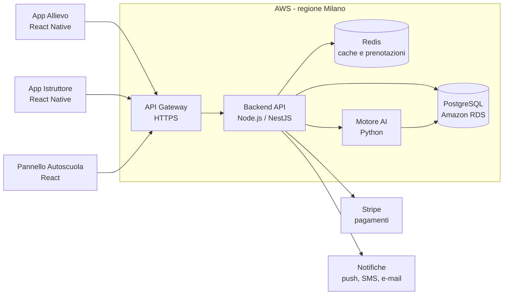
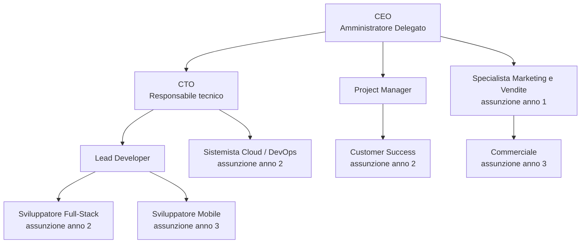
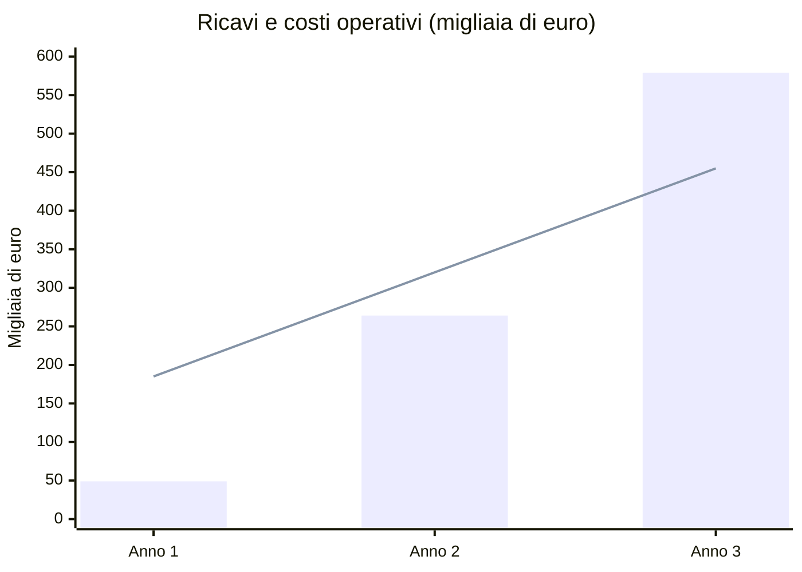

# Business Plan – Semaforo Verde S.r.l.

**La piattaforma che porta le autoscuole italiane nel digitale**

*Start-up Innovativa · Documento riservato per investitori · Novembre 2026*

---

## Indice

1. [Executive Summary](#1-executive-summary)
2. [Descrizione dell'azienda e del prodotto](#2-descrizione-dellazienda-e-del-prodotto)
3. [Analisi di mercato e strategia di marketing](#3-analisi-di-mercato-e-strategia-di-marketing)
4. [Piano di organizzazione e risorse umane](#4-piano-di-organizzazione-e-risorse-umane)
5. [Piano finanziario](#5-piano-finanziario)
6. [Rischi e contromisure](#6-rischi-e-contromisure)
7. [Fonti e ipotesi](#7-fonti-e-ipotesi)

---

## 1. Executive Summary

### Chi siamo

**Semaforo Verde S.r.l.** è una start-up innovativa fondata da quattro sviluppatori e analisti. Realizziamo una piattaforma web e mobile in abbonamento (SaaS) che permette a qualsiasi autoscuola di gestire online allievi, guide pratiche, istruttori, pagamenti e preparazione all'esame di teoria.

### Vision

Un'Italia in cui prendere la patente sia semplice, trasparente e sicuro, e in cui ogni autoscuola, anche la più piccola, abbia strumenti digitali all'altezza dei grandi operatori.

### Mission

Dare alle autoscuole indipendenti un unico strumento, facile e a costo accessibile, per risparmiare tempo nella gestione quotidiana, offrire agli allievi un'esperienza moderna e aumentare la percentuale di promossi.

### Il problema

- In Italia vengono rilasciate **circa 1,2 milioni di patenti all'anno** (1.193.480 nel 2024, dati del Ministero delle Infrastrutture e dei Trasporti), ma la maggior parte delle autoscuole lavora ancora con **telefono, agende di carta, fogli Excel e WhatsApp**.
- Le segreterie perdono ore ogni settimana a spostare guide, ricordare scadenze del foglio rosa e sollecitare pagamenti.
- Gli allievi non sanno quando potranno fare la prossima guida e studiano la teoria su app generiche: **circa 4 candidati su 10 non superano l'esame di teoria** al primo tentativo, con costi e ritardi per famiglie e autoscuole.
- Nuovi operatori digitali finanziati da venture capital stanno aprendo **autoscuole online concorrenti** nelle grandi città: l'autoscuola tradizionale rischia di perdere clienti se non si digitalizza.

### La soluzione

Semaforo Verde offre, con un solo abbonamento mensile:

1. **App per l'allievo** con il logo dell'autoscuola: prenotazione delle guide in tempo reale, pagamenti online, stato della pratica, quiz ministeriali con **tutor di intelligenza artificiale** che individua gli argomenti deboli.
2. **Pannello web per l'autoscuola**: calendario istruttori e veicoli, anagrafica allievi, scadenze automatiche, incassi, statistiche.
3. **App per l'istruttore**: agenda del giorno, scheda di valutazione di ogni guida, comunicazioni con l'allievo.

L'autoscuola **non diventa nostra concorrente**: resta proprietaria del cliente, e noi le diamo gli strumenti per competere con i nuovi player digitali.

### Fabbisogno finanziario

Chiediamo **230.000 €** a un Business Angel o a un fondo seed, che si aggiungono a **20.000 €** di capitale versato dai soci (totale **250.000 €**). In cambio offriamo il **20% delle quote** (valutazione pre-money di 920.000 €).

| Utilizzo dei fondi | Importo | % |
|---|---:|---:|
| Copertura dei costi operativi fino al pareggio (stipendi, cloud, marketing) | 200.000 € | 80% |
| Investimenti iniziali (CapEx) | 17.000 € | 7% |
| Riserva di sicurezza | 33.000 € | 13% |
| **Totale** | **250.000 €** | **100%** |

### I numeri chiave

| | Anno 1 (2027) | Anno 2 (2028) | Anno 3 (2029) |
|---|---:|---:|---:|
| Autoscuole clienti (a fine anno) | 60 | 200 | 404 |
| Ricavi | 48.780 € | 264.150 € | 578.655 € |
| EBITDA (margine operativo lordo) | −136.556 € | −55.770 € | **+123.819 €** |

**Pareggio mensile al 22° mese (ottobre 2028)**, con circa 180-200 autoscuole clienti, pari a meno del 3% del mercato italiano.

> **Perché investire in Semaforo Verde**
> - Mercato grande, stabile e poco digitalizzato: ogni anno oltre un milione di nuovi patentati.
> - Ricavi ricorrenti da abbonamento, prevedibili e con margine lordo superiore al 90%.
> - Il mercato è già validato: nel 2025 la startup italiana Guidoio ha raccolto 3,5 milioni di euro per digitalizzare la patente. Noi serviamo le migliaia di autoscuole che non vogliono essere sostituite, ma rinnovate.
> - Team tecnico che sviluppa il prodotto internamente, senza costi di sviluppo esterni.

---

## 2. Descrizione dell'azienda e del prodotto

### 2.1 Forma giuridica: Start-up Innovativa S.r.l.

Costituiremo una **società a responsabilità limitata iscritta nella sezione speciale del Registro delle Imprese come start-up innovativa** (D.L. 179/2012). La scelta è motivata da:

- **Responsabilità limitata**: i soci rischiano solo il capitale conferito.
- **Requisiti soddisfatti**: oggetto sociale esclusivamente tecnologico e innovativo; spese in ricerca e sviluppo superiori al 15% dei costi; registrazione del software proprietario nel Registro Pubblico Speciale per i Programmi per Elaboratore.
- **Vantaggi per chi investe**: gli investitori in start-up innovative possono beneficiare di **detrazioni fiscali IRPEF** sull'importo investito, rendendo l'investimento in Semaforo Verde più conveniente.
- **Vantaggi per la società**: esenzione da alcuni diritti camerali e bolli, accesso semplificato al Fondo di Garanzia per le PMI, possibilità di raccogliere capitale tramite equity crowdfunding, accesso a bandi come Smart&Start Italia (Invitalia), flessibilità nella remunerazione con stock option.
- **Capitale sociale**: 20.000 €, versato in parti uguali dai quattro soci fondatori.

### 2.2 Il prodotto

| Modulo | Utente | Funzioni principali |
|---|---|---|
| **App Allievo** (iOS/Android) | Allievi | Prenotazione e disdetta guide, pagamenti online, quiz ministeriali con tutor AI, stato della pratica e scadenze, notifiche |
| **Pannello Autoscuola** (web) | Titolare e segreteria | Calendario istruttori e veicoli, anagrafica allievi, gestione pratiche, incassi e solleciti automatici, statistiche e report |
| **App Istruttore** (iOS/Android) | Istruttori | Agenda giornaliera, scheda di valutazione di ogni guida, note per l'allievo, segnalazione disponibilità |

Ogni autoscuola ottiene **un'app con il proprio nome e logo** (white label), così rafforza il proprio marchio invece di quello di un intermediario.

### 2.3 Architettura tecnica

La piattaforma è **cloud-native e multi-tenant**: un'unica infrastruttura serve tutte le autoscuole, con i dati di ciascuna isolati in modo sicuro.

| Livello | Tecnologia | Motivazione |
|---|---|---|
| Cloud | **Amazon Web Services**, regione Milano (eu-south-1) | Dati in Italia (conformità GDPR), scalabilità automatica, alta affidabilità |
| Database | **PostgreSQL** (Amazon RDS) + **Redis** per cache e prenotazioni in tempo reale | Affidabile, open source, transazioni sicure per prenotazioni e pagamenti |
| Backend | **Node.js** (NestJS) con API REST | Veloce, ampia disponibilità di sviluppatori, stesso linguaggio del frontend |
| Motore AI | Microservizio **Python** (scikit-learn) | Algoritmo proprietario di studio adattivo e previsione della probabilità di superare l'esame |
| Frontend web | **React** | Interfaccia moderna e reattiva per il pannello dell'autoscuola |
| App mobile | **React Native** | Un solo codice per iOS e Android: costi di sviluppo dimezzati |
| Pagamenti | **Stripe** | Carte, Apple Pay, Google Pay, standard di sicurezza PCI-DSS |
| Notifiche | Firebase Cloud Messaging, SMS, e-mail | Promemoria guide e scadenze |
| Sicurezza | HTTPS/TLS, cifratura dei dati, autenticazione a due fattori, backup giornalieri | Protezione dei dati personali degli allievi |

### 2.4 Innovazione tecnologica: perché siamo migliori

1. **Tutor AI per la teoria (algoritmo proprietario).** Il sistema analizza ogni risposta dell'allievo, riconosce gli argomenti deboli e ripropone le domande con una tecnica di *ripetizione spaziata*. Un indicatore di "prontezza all'esame" mostra all'allievo e all'autoscuola quando è il momento giusto di prenotare l'esame, riducendo le bocciature.
2. **Calendario intelligente.** L'algoritmo di pianificazione incastra automaticamente guide, istruttori e veicoli, riempie i buchi lasciati dalle disdette proponendo lo slot libero agli allievi in lista d'attesa e riduce le ore perse.
3. **Scalabilità.** L'architettura multi-tenant su AWS permette di passare da 10 a 10.000 autoscuole senza riscrivere il software: il costo del cloud per cliente scende con la crescita.
4. **Sicurezza e privacy.** Dati ospitati in Italia, cifrati e protetti da autenticazione a due fattori, nel pieno rispetto del GDPR.
5. **Semplicità.** Attivazione in un giorno, nessuna installazione, importazione guidata degli allievi da Excel.

---

## 3. Analisi di mercato e strategia di marketing

### 3.1 Il mercato

- **Domanda:** circa **1,2 milioni di patenti rilasciate ogni anno** in Italia, in crescita del 29% rispetto al 2014.
- **Offerta:** si stimano **circa 7.000 autoscuole** sul territorio nazionale, per la maggior parte piccole imprese familiari con 1-3 sedi.
- **Mercato servibile:** le autoscuole indipendenti con 1-3 sedi, circa il 70% del totale (**≈ 4.900 autoscuole**).
- **Valore del mercato servibile:** 4.900 autoscuole × 135 € al mese × 12 mesi ≈ **7,9 milioni di euro di ricavi ricorrenti all'anno**.
- **Il nostro obiettivo:** 404 autoscuole entro la fine del 2029, cioè **meno del 6% del mercato totale**.

### 3.2 Target di riferimento (B2B2C)

| Segmento | Chi è | Bisogno principale | Chi paga |
|---|---|---|---|
| **Cliente principale** | Titolari di autoscuole indipendenti (1-3 sedi, 2-8 istruttori) | Risparmiare tempo in segreteria, non perdere clienti verso le autoscuole digitali | Paga l'abbonamento |
| **Utente finale** | Allievi di 17-25 anni, nativi digitali | Prenotare le guide dal telefono, studiare in modo efficace | Gratis (incluso nel servizio dell'autoscuola) |
| **Segmento secondario (anno 3)** | Piccole catene di autoscuole e consorzi | Gestione centralizzata di più sedi | Piano Multi-sede |

### 3.3 Analisi dei concorrenti

Abbiamo individuato tre tipi di concorrenti diretti:

1. **Guidoio** – startup italiana fondata nel 2023 che digitalizza l'intero percorso della patente (iscrizione, pratiche, prenotazione guide, tutor AI). Nel 2025 ha raccolto 3,5 milioni di euro. È **un'autoscuola digitale rivolta direttamente agli allievi**, quindi è un concorrente delle autoscuole stesse; è presente in poche grandi città.
2. **Gestionali tradizionali per autoscuole** (es. Dylog *Linea Patente*) – software storici e diffusi per la gestione delle pratiche e della contabilità. Sono affidabili sulla parte amministrativa ma pensati per la segreteria, con un'esperienza mobile per gli allievi limitata o assente.
3. **App di quiz patente** (es. iPatente, app dei principali editori di materiale didattico) – ottime per studiare la teoria, ma non gestiscono guide, istruttori e pagamenti, e non sono collegate all'autoscuola.

### 3.4 Matrice di confronto

| Caratteristica | **Semaforo Verde** | Guidoio | Gestionale tradizionale | App di quiz |
|---|:---:|:---:|:---:|:---:|
| Prenotazione guide online in tempo reale | ✅ | ✅ | ⚠️ parziale | ❌ |
| App con il marchio dell'autoscuola | ✅ | ❌ | ❌ | ❌ |
| Quiz con tutor AI adattivo | ✅ | ✅ | ❌ | ⚠️ parziale |
| Pagamenti online integrati | ✅ | ✅ | ⚠️ parziale | ❌ |
| App per gli istruttori | ✅ | ⚠️ in sviluppo | ❌ | ❌ |
| Gestione pratiche e contabilità avanzata | ⚠️ base (integrazioni) | ✅ | ✅ | ❌ |
| Disponibile per qualsiasi autoscuola in Italia | ✅ | ❌ solo alcune città | ✅ | ✅ |
| L'autoscuola resta proprietaria del cliente | ✅ | ❌ | ✅ | ✅ |
| Prezzo accessibile, senza installazione | ✅ | n.d. | ⚠️ licenze e installazione | ✅ |

*✅ sì · ⚠️ parziale · ❌ no · n.d. non disponibile. Valutazione basata sulle informazioni pubbliche dei concorrenti.*

**Punti di forza di Semaforo Verde:** unica soluzione completa (allievo + autoscuola + istruttore) che rafforza il marchio dell'autoscuola invece di sostituirla; prezzo accessibile; attivazione immediata.

**Punti di debolezza e come li gestiamo:** marchio ancora sconosciuto (programma pilota gratuito e passaparola tra titolari); gestione contabile meno avanzata dei gestionali storici (integrazione e esportazione dei dati verso i software di contabilità già in uso, invece di sostituirli).

### 3.5 Strategia di prezzo (Pricing Model): SaaS in abbonamento

Abbiamo scelto un modello **SaaS con abbonamento mensile per sede**, perché garantisce ricavi ricorrenti e prevedibili e un costo basso e chiaro per l'autoscuola. L'app resta **gratuita per gli allievi**.

| Piano | Prezzo mensile per sede | Per chi | Incluso |
|---|---:|---|---|
| **Base** | 79 € | Autoscuole piccole, fino a 150 allievi attivi | Pannello web, app allievo e istruttore, prenotazione guide, notifiche |
| **Pro** *(il più scelto)* | 149 € | Autoscuole medie, allievi illimitati | Tutto il Base + tutor AI, pagamenti online, app con il proprio logo, statistiche |
| **Multi-sede** | 249 € | Catene e consorzi | Tutto il Pro + gestione centralizzata, report consolidati, assistenza prioritaria |

- **Attivazione una tantum:** 300 € (configurazione, importazione dati, formazione dello staff).
- **Sconto annuale:** 2 mesi gratis con pagamento anticipato annuale.
- **Prova gratuita:** 30 giorni.
- **Ricavo medio per cliente (ipotesi del piano):** **135 € al mese**, considerando un mix di circa 20% Base, 70% Pro e 10% Multi-sede.

Per un'autoscuola il piano Pro costa **meno di 5 € al giorno**: basta risparmiare un'ora di segreteria a settimana o recuperare due guide disdette al mese per ripagarlo.

### 3.6 Strategia di marketing e vendita

1. **Programma pilota (gennaio-aprile 2027):** 5 autoscuole della nostra zona usano gratis il prodotto e ci aiutano a migliorarlo; diventano i nostri primi casi di successo e testimonial.
2. **Vendita diretta:** dimostrazioni online e visite in sede, gestite dal CEO e dallo specialista marketing e vendite.
3. **Marketing digitale:** campagne Google Ads (ricerche come "gestionale autoscuola") e Meta Ads mirate ai titolari; contenuti su LinkedIn e YouTube.
4. **Fiere e associazioni di categoria:** presenza agli eventi del settore e accordi con associazioni e consorzi di autoscuole.
5. **Passaparola:** un mese gratis per ogni autoscuola presentata da un cliente.
6. **Effetto rete:** ogni allievo che usa l'app porta il nostro nome in famiglia e tra gli amici, aumentando la notorietà presso altre autoscuole.

---

## 4. Piano di organizzazione e risorse umane

### 4.1 Organigramma

### 4.2 Ruoli dei soci fondatori

| Ruolo | Socio | Responsabilità |
|---|---|---|
| **CEO** – Amministratore Delegato | *[nome del socio]* | Strategia, rapporti con gli investitori, vendite ai primi clienti, partnership con le associazioni di categoria |
| **CTO** – Responsabile tecnico | *[nome del socio]* | Architettura della piattaforma, cloud e sicurezza, motore AI, scelte tecnologiche |
| **Project Manager** | *[nome del socio]* | Pianificazione dei rilasci (metodologia Agile/Scrum), raccolta dei bisogni delle autoscuole, qualità e assistenza |
| **Lead Developer** | *[nome del socio]* | Sviluppo di backend, app e pannello web, revisione del codice, coordinamento degli sviluppatori |

Le quote sono divise in parti uguali tra i quattro fondatori (25% ciascuno prima dell'ingresso dell'investitore).

### 4.3 Piano di assunzioni

| Figura | Quando | Costo aziendale annuo | Perché serve |
|---|---|---:|---|
| Specialista Marketing e Vendite | Anno 1 (maggio 2027, al lancio) | 33.600 € | Generare contatti, gestire le campagne e chiudere i contratti |
| Sviluppatore Full-Stack | Anno 2 (gennaio 2028) | 36.000 € | Accelerare lo sviluppo di nuove funzioni |
| Customer Success | Anno 2 (gennaio 2028) | 31.200 € | Formazione e assistenza ai clienti, riduzione degli abbandoni |
| Sistemista Cloud / DevOps | Anno 3 (gennaio 2029) | 36.000 € | Affidabilità e sicurezza dell'infrastruttura con 400+ clienti |
| Commerciale | Anno 3 (gennaio 2029) | 33.600 € | Espansione in nuove regioni e verso le catene di autoscuole |

**Organico:** 5 persone a fine anno 1, 7 a fine anno 2, 9 a fine anno 3.

---

## 5. Piano finanziario

*Il piano copre gli anni 2027-2029. La società viene costituita a dicembre 2026; i primi quattro mesi del 2027 sono dedicati allo sviluppo del prodotto e al programma pilota, il lancio commerciale avviene a maggio 2027.*

### 5.1 Investimenti iniziali (CapEx)

| Voce | Importo |
|---|---:|
| 5 computer portatili per lo sviluppo | 6.500 € |
| Smartphone e tablet di test (iOS e Android) | 1.500 € |
| Monitor e periferiche | 1.000 € |
| Licenze software e account sviluppatore (Apple, Google, strumenti di sviluppo) | 1.500 € |
| Spese di costituzione della società (notaio, Camera di Commercio, iscrizione start-up innovativa) | 2.500 € |
| Registrazione del marchio e domini | 1.000 € |
| Identità visiva e sito web | 3.000 € |
| **Totale CapEx** | **17.000 €** |

*Non sono previsti server fisici: tutta l'infrastruttura è in cloud e rientra nei costi operativi, pagata in base all'uso effettivo. Gli investimenti sono ammortizzati in 3 anni (circa 5.700 € all'anno).*

### 5.2 Costi operativi annuali (OpEx)

| Voce | Anno 1 | Anno 2 | Anno 3 |
|---|---:|---:|---:|
| Stipendi soci fondatori (4 persone) | 110.400 € | 129.600 € | 148.800 € |
| Stipendi dipendenti | 22.400 € | 100.800 € | 170.400 € |
| Cloud AWS e servizi tecnici di base | 3.600 € | 6.000 € | 9.600 € |
| Pubblicità (Google Ads, Meta Ads, fiere) | 30.000 € | 42.000 € | 54.000 € |
| Consulenze legali, commercialista e privacy (GDPR) | 7.200 € | 8.400 € | 9.600 € |
| Ufficio in coworking | 6.000 € | 9.600 € | 12.000 € |
| Strumenti software (licenze, abbonamenti) | 3.000 € | 4.200 € | 5.400 € |
| **Totale costi fissi** | **182.600 €** | **300.600 €** | **409.800 €** |
| Costi variabili (cloud per cliente, SMS, commissioni, assistenza: 12 € al mese per cliente) | 2.736 € | 19.320 € | 45.036 € |
| **Totale costi operativi** | **185.336 €** | **319.920 €** | **454.836 €** |

*I fondatori partono con un compenso contenuto (circa 2.300 € al mese di costo aziendale ciascuno nell'anno 1), che cresce con la società: dimostra il loro impegno e riduce il fabbisogno di capitale.*

### 5.3 Previsione dei ricavi (3 anni)

**Ipotesi principali:**
- Ricavo medio per cliente: 135 € al mese + 300 € di attivazione.
- Nuovi clienti: da 4 al mese al lancio fino a 11 al mese a fine 2027; 12-14 al mese nel 2028; 20 al mese nel 2029.
- Tasso di abbandono (churn): 1% dei clienti al mese.

| | Anno 1 (2027) | Anno 2 (2028) | Anno 3 (2029) |
|---|---:|---:|---:|
| Nuove autoscuole acquisite | 60 | 156 | 240 |
| Autoscuole clienti a fine anno | 60 | 200 | 404 |
| Quota del mercato italiano (≈ 7.000 autoscuole) | 0,9% | 2,9% | 5,8% |
| Ricavi da abbonamenti | 30.780 € | 217.350 € | 506.655 € |
| Ricavi da attivazioni | 18.000 € | 46.800 € | 72.000 € |
| **Ricavi totali** | **48.780 €** | **264.150 €** | **578.655 €** |
| Ricavi ricorrenti annui a fine anno (ARR) | 97.200 € | 324.000 € | 654.480 € |

*Barre: ricavi totali · Linea: costi operativi totali.*

### 5.4 Conto economico previsionale

| | Anno 1 | Anno 2 | Anno 3 |
|---|---:|---:|---:|
| Ricavi | 48.780 € | 264.150 € | 578.655 € |
| − Costi variabili | −2.736 € | −19.320 € | −45.036 € |
| **Margine di contribuzione** | **46.044 €** | **244.830 €** | **533.619 €** |
| − Costi fissi | −182.600 € | −300.600 € | −409.800 € |
| **EBITDA** | **−136.556 €** | **−55.770 €** | **+123.819 €** |
| − Ammortamenti | −5.667 € | −5.667 € | −5.666 € |
| **Risultato prima delle imposte** | **−142.223 €** | **−61.437 €** | **+118.153 €** |

*Nell'anno 3 le imposte sul reddito (IRES) sono in gran parte compensate dalle perdite fiscali degli anni precedenti, che per legge possono essere riportate a nuovo.*

### 5.5 Break-Even Analysis (punto di pareggio)

**Margine di contribuzione per cliente** = 135 € (canone) − 12 € (costi variabili) = **123 € al mese**.

**Punto di pareggio in numero di clienti** = costi fissi mensili ÷ margine per cliente:

| Struttura dei costi | Costi fissi mensili | Clienti necessari al pareggio |
|---|---:|---:|
| Anno 2 (7 persone) | 25.050 € | 25.050 ÷ 123 ≈ **204 autoscuole** |
| Anno 3 (9 persone) | 34.150 € | 34.150 ÷ 123 ≈ **278 autoscuole** |

**Punto di pareggio nel tempo:** considerando anche le quote di attivazione dei nuovi clienti, i ricavi mensili superano i costi mensili dal **22° mese (ottobre 2028)**, con 176 autoscuole clienti. Da quel momento la società si autofinanzia (con una breve eccezione a gennaio 2029, quando entrano i nuovi assunti dell'anno 3).

**Fabbisogno massimo di cassa:** le perdite cumulate raggiungono il punto più basso a settembre 2028 (circa **−199.000 €** di gestione operativa, più 17.000 € di CapEx). Il finanziamento di 250.000 € copre interamente questo fabbisogno e lascia una **riserva di sicurezza di circa 33.000 €**.

**Cassa a fine 2029:** circa **164.000 €**, e oltre 20.000 € di utile operativo al mese, sufficienti a finanziare l'espansione nazionale senza nuovi aumenti di capitale.

### 5.6 Andamento della cassa

| Momento | Clienti | Risultato operativo del mese | Cassa disponibile* |
|---|---:|---:|---:|
| Aprile 2027 (fine pilota) | 0 | −13.350 € | 179.600 € |
| Dicembre 2027 | 60 | −5.470 € | 96.400 € |
| Ottobre 2028 (pareggio) | 176 | +798 € | 34.700 € |
| Dicembre 2028 | 200 | +3.750 € | 40.700 € |
| Dicembre 2029 | 404 | +21.542 € | 164.500 € |

*\* Cassa = 250.000 € di finanziamento − 17.000 € di CapEx + risultati operativi cumulati (stima semplificata, senza considerare IVA e tempi di incasso).*

### 5.7 Cosa ottiene l'investitore

- **20% della società** per 230.000 €.
- Società in utile operativo dal terzo anno, con oltre **650.000 € di ricavi ricorrenti annui** a fine 2029.
- Benefici fiscali previsti per chi investe in start-up innovative.
- Possibili sviluppi futuri: espansione in altri Paesi europei, nuovi servizi (scuole nautiche, patenti professionali), vendita a un gruppo del settore software o editoria didattica.

---

## 6. Rischi e contromisure

| Rischio | Probabilità | Contromisura |
|---|:---:|---|
| Le autoscuole sono restie a cambiare abitudini | Media | Prova gratuita di 30 giorni, attivazione e importazione dati fatte da noi, formazione inclusa |
| Crescita dei clienti più lenta del previsto | Media | Riserva di cassa di 33.000 €; le assunzioni degli anni 2 e 3 vengono rinviate se gli obiettivi non sono raggiunti |
| Concorrenza di startup ben finanziate | Alta | Posizionamento diverso: siamo alleati delle autoscuole, non loro concorrenti |
| Sicurezza e protezione dei dati | Bassa | Cloud certificato in Italia, cifratura, backup, consulente privacy |
| Cambiamenti normativi sulla patente | Bassa | Piattaforma modulare, aggiornamento rapido di quiz e procedure |

---

## 7. Fonti e ipotesi

- Patenti rilasciate in Italia: 1.193.480 nel 2024, +29% rispetto al 2014 (Ministero delle Infrastrutture e dei Trasporti, via Adnkronos; riportato da [alVolante](https://www.alvolante.it/news/aumentano-patenti-emesse-periodo-2014-2024-407897)).
- Esiti degli esami di teoria: circa il 40% dei candidati non supera la prova ([SicurAUTO](https://www.sicurauto.it/news/attualita-e-curiosita/esami-patente-quasi-il-40-non-supera-la-teoria)).
- Guidoio: round seed da 3,5 milioni di euro nel 2025 ([Forbes Italia](https://forbes.it/2025/11/17/la-startup-italiana-guidoio-raccoglie-35-milioni-di-euro-per-digitalizzare-le-autoscuole/)).
- Numero di autoscuole in Italia (circa 7.000): stima di settore utilizzata come ipotesi di lavoro.
- Prezzi, costi, stipendi, tassi di crescita e di abbandono sono ipotesi del gruppo, scelte in modo prudente; tutti i calcoli del piano finanziario sono coerenti tra loro e con l'Executive Summary.
